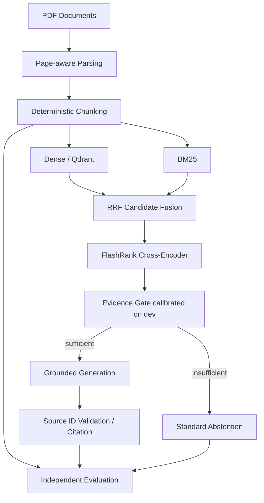

# TrustRAG

基于混合检索、证据引用与校准拒答的企业知识库问答系统。基于 MIT 开源项目 RagBase 二次开发，围绕 **Retrieval + Grounding + Evaluation**，不引入 Agent、GraphRAG、训练或分布式基础设施。

## 1. Project Overview

PDF 按页解析并生成稳定 chunk ID；Dense 与 BM25 使用同一份文本和身份，经 RRF 融合后由 FlashRank 重排。证据门限由 dev 集校准；证据不足时直接拒答。生成答案使用 `[S1]` 等引用，并检查来源 ID。独立评测流程保存逐题检索、答案、judge 输出和计时，指标可重算。

## 2. Upstream Project

- Upstream: [curiousily/ragbase](https://github.com/curiousily/ragbase)，作者 Venelin Valkov。
- 原始 commit: `5af7b79162329fa0b725b39d1aeeea7eb1e4428b`。
- 原始架构与依赖：[docs/upstream_baseline.md](docs/upstream_baseline.md)。
- 已实际复现原版上传、解析、分块、Qdrant、检索、重排、本地生成及 UI：[docs/baseline_reproduction.md](docs/baseline_reproduction.md)。
- 原版实验使用 `git archive` 冻结源码，避免后续开发悄悄改变基线。

PDF ingestion、Semantic/Recursive Chunking、FastEmbed、Qdrant、FlashRank、Streamlit、Ollama/Groq 和对话历史是原项目已有能力，不是本项目的原创贡献。

## 3. Motivation

原项目主要依赖 Dense 检索和提示词拒答，丢失原始页码，引用只是在答案下展开片段，也缺少固定评测。本项目让检索方法、来源、拒答依据与失败原因都可以检查，并把开发集选择与测试集报告分开。

## 4. Architecture



新流程位于 `ragbase/ingestion`、`retrieval`、`generation`、`evaluation`。保留原始模块与冻结复现入口，便于追溯与渐进迁移。

## 5. My Contributions

1. Dense + BM25 混合检索与 RRF；统一 `RetrievalResult` 和稳定 chunk 身份。
2. 将原有 FlashRank 接入可控候选池，建立五组受控检索比较。
3. 按页 metadata、答案内 source-level citation、来源 ID 与无效引用检查。
4. 根据 dev 正负样本扫描 top1、top3 mean、margin，选择证据门限与拒答策略。
5. 固定语料、dev/test benchmark、独立检索/生成评测、实验工件、消融、失败分类和指标重算。

这些是系统改造与实验工程贡献；RRF、BM25、已有模型及 upstream 功能不被描述为新算法发明。

## 6. Dataset / Knowledge Base

`data/documents/` 包含 10 份公开可审计的虚构 Northstar Labs 政策 PDF、共 120 页。每页一个事实目标，正文包含程序性说明。没有真实员工资料或企业机密。

文档覆盖员工手册、请假、报销、IT 安全、远程办公、产品手册、定价、客服、入职和采购。[data/README.md](data/README.md) 说明来源、构造方法和局限；`data/source/facts.jsonl` 保存事实；`data/benchmark/manifest.json` 保存文件 SHA-256。

## 7. Benchmark

| Split | Answerable | Unanswerable | Total |
| --- | ---: | ---: | ---: |
| dev | 30 | 10 | 40 |
| test | 90 | 30 | 120 |
| total | 120 | 40 | 160 |

按文档分层、seed=42；两组问题和事实目标分离。语料共用，这是知识库检索评测，并非未见文档泛化评测。原始 gold 用文件名、1-based 页码和事实 span 标注；`benchmark_aligned.jsonl` 把实际保留的 span 映射到稳定 chunk ID，无法对齐则失败。

参数、chunking 和门限只在 dev 上选择。正式 test 的输入、代码、模型和配置写入 `experiments/formal_test_freeze.json`，检查点只能按同一配置恢复；已完成的预测不被手工改写。

## 8. Retrieval Pipeline

- Dense：原 BGE `BAAI/bge-base-en-v1.5`、FastEmbed、Qdrant cosine retrieval。
- BM25：Okapi BM25、统一 query/document tokenizer、倒排 postings。
- RRF：`sum(1 / (k + rank))`，按排名融合，不比较不同尺度的原始分数。
- 重排：原有 `ms-marco-MiniLM-L-12-v2`，保留共享身份和 component scores。
- dev 选择：Recursive 2048/128；候选深度 10、RRF k=60；保存排名 Top-10，生成使用 Top-5。

配置位于 `configs/baseline.yaml`、`dense_reranker.yaml`、`bm25.yaml`、`hybrid.yaml`、`hybrid_reranker.yaml`。所有受控组共用 corpus、chunking、embedding、question set 和 Top-K 定义。

## 9. Answerability / Citation

证据分数是相关性特征，不是答案正确概率。三种特征在各检索模式自己的分数尺度上扫描门限。主方案使用 dev 校准的 top1 重排分数；完整扫描见 [reports/answerability_calibration.md](reports/answerability_calibration.md)。

低于门限直接返回统一拒答，并跳过 LLM。通过门限后，模型仍须只根据来源回答并使用 `[S1]`。无效/缺失 source ID 被拦截，原始输出保留供审计。模型拒答后不会继续发布补充的参数知识。

每条引用映射到实际文件、页码、chunk 和提供给模型的 excerpt。默认每个来源最多 1024 字符，截取到完整词边界；保存引用 excerpt 的起止偏移。来源 ID 合法性不能保证语义支持，因此另做固定 LLM judge 与抽样复核。

## 10. Experiments

正式矩阵：Dense、Dense + Reranker、BM25、Hybrid、Hybrid + Reranker。原版整文档分块基线单独见 [docs/original_baseline_results.md](docs/original_baseline_results.md)，不能把它与页码分块组的差异直接归因于 RRF。

每组保存配置、resolved config、aligned gold、chunks、retrieval/generation predictions、metrics、raw judge results、模型计数、检查点和 `run.log`。正式结果已完成，见 [reports/comparison.md](reports/comparison.md)。主方案 MRR 0.9889，Dense 0.9615；两者 Recall@5 均为 1.0000。主方案端到端 Answerability F1 0.9655，FAR 0、FRR 0.0667。六组共 720 条系统结果，全部通过预测重算一致性检查。

检索指标为 Recall@1/3/5/10、MRR、nDCG@5；无答案问题不进入 ranking 指标，仍进入 latency。生成正确性和 groundedness 使用固定 `gemma2:9b` judge、固定 prompt、temperature=0、seed=42；逐题保存 raw/parsed 标签。Citation Accuracy 是 gold-source precision；语义支持另报 judge 指标。Answerability/FAR/FRR 根据 gold booleans 和实际发布状态确定。

## 11. Ablation

- [Chunking](reports/chunking_ablation.md)：Fixed、Recursive、Semantic + Recursive；其他检索设置固定。三者 dev MRR 同为 1.0000，按预定平局规则选择 Recursive。
- [Candidate/RRF](reports/retrieval_tuning.md)：候选 10/20/40 与 RRF k=10/60/100 的小型 dev 网格。深度 10 与 40 的 MRR 相同，选择 10。
- Gate：正式矩阵预先声明主方案 gate on/off 对照，复用相同 test 检索输入，重新执行真实生成与 judge。

本轮 gate off 的 F1 为 0.9944，gate on 为 0.9655，FAR 均为 0。证据门限增加误拒答，未测得误答率收益。保留真实结果，不用 test 重新选择门限；gate 单独的 test F1 0.8901 与端到端 F1 分开报告。

## 12. Failure Analysis

已生成 `reports/failure_analysis.csv` 和 `.md`，区分 Retrieval Miss、Ranking Error、Chunk Boundary Error、Insufficient Context、Generation Hallucination、Wrong Citation、False Refusal、False Answer，另区分有依据但答错的问题与 judge 失败。主方案有 6 个按原始 gold 计算的误拒答；20 条 Codex 语义复核见 [reports/sample_review.md](reports/sample_review.md)，其中一条发现 Finance 角色表述歧义，未修改 test 标签。

分类为可复核的多标签假设，百分比分母为问题数。`reports/review_samples.jsonl` 提供失败及对照样本、gold、完整引用 excerpt、原始答案、门限和 judge 解释；独立人工核验不由自动标签替代。

## 13. Demo

启动本地 Ollama 与 Streamlit 后访问 `http://127.0.0.1:8501`。界面展示问题、答案、来源、检索方式、证据评分与回答/拒答状态，上传与索引按会话隔离。算法评测后已实际验证引用回答、拒答、PDF 上传页码和清空记录：[UI 验证](docs/demo_ui_results.json)。

默认演示知识库使用已校准的固定 corpus。上传其他 PDF 后，门限存在域迁移限制，需要针对新语料建立 dev benchmark 后重新校准。

## 14. Installation

要求 Python 3.12，已验证环境为 Windows、Python 3.12.7、RTX 4060 Laptop GPU 8GB。模型与硬件记录见 [docs/model_artifacts.json](docs/model_artifacts.json)。

```powershell
powershell -ExecutionPolicy Bypass -File scripts/setup.ps1
.venv\Scripts\python.exe -m scripts.prefetch_models
.venv\Scripts\python.exe scripts/download_ollama.py --version 0.35.1
powershell -ExecutionPolicy Bypass -File scripts/start_local.ps1
.venv\Scripts\python.exe scripts/pull_local_model.py --model gemma2:9b
$env:HF_HUB_OFFLINE = '1'
.venv\Scripts\python.exe -m streamlit run app.py
```

下载需要联网；其后本地推理、检索和生成不需要付费 API。便携服务和模型位于被 Git 忽略的 `.runtime/`。安装脚本把 Poetry 工具环境与项目环境分开，避免工具依赖影响已锁定的 RAG 依赖。

## 15. Reproduction

```powershell
$env:HF_HUB_OFFLINE = '1'
.venv\Scripts\python.exe -m pytest tests -q
.venv\Scripts\python.exe -m ruff check ragbase scripts tests
.venv\Scripts\python.exe -m pip check

# 先复现原版；原始 source 与平台兼容细节见 baseline_reproduction.md
.venv\Scripts\python.exe scripts/export_upstream.py
.venv\Scripts\python.exe -m streamlit run scripts/baseline_app.py

# dev 开发过程；这些命令会重新选择 dev 参数，请使用独立 checkout
.venv\Scripts\python.exe -m scripts.run_ablation --kind chunking
.venv\Scripts\python.exe -m scripts.run_ablation --kind retrieval
.venv\Scripts\python.exe -m scripts.run_dev_matrix
.venv\Scripts\python.exe -m scripts.calibrate_answerability

# 固定已发布参数重现 test；独立目录保护原始工件
.venv\Scripts\python.exe -m scripts.run_benchmark --output-root experiments/reproduction --phase all

# 只从保存的预测重算，不重新调用模型
.venv\Scripts\python.exe -m scripts.recompute_metrics experiments/hybrid_reranker
```

恢复中断运行时使用同一个 output-root；freeze 校验不允许中途换参数。模型 prefetch 固定 Hugging Face revision，并校验 BGE/FlashRank 文件哈希；Ollama 与 LLM digest 同样校验。不同硬件/运行时的生成结果未保证逐字节一致。

## 16. Limitations

- 160 题、单事实单页、模板性虚构语料，较真实企业知识库容易；尚未达到建议的更大自然文档 benchmark。
- 相同 dev 集承担小型参数选择与阈值拟合，40 题较小，存在过拟合风险；test 保持隔离。
- BGE 与 reranker 为英语模型，本轮正式评测仅覆盖英语、自包含、单轮问题。
- 页码解析不包含 OCR，扫描 PDF 或复杂跨页证据不属于已验证能力。
- 高相关性不等于答案存在；门限在其他语料上需要重新校准。
- 引用 ID 检查不能证明每个 claim 的正确性。Judge 与 generator 使用同一模型族，可能有偏差；独立人工审核仍重要。
- Groq 接口能力保留，本轮没有用远程 API 做正式测量。

## 17. License / Attribution

保留原始 MIT [LICENSE](LICENSE) 与作者 attribution。新增项目代码沿用 MIT。第三方模型与依赖遵循各自许可证。个人改造文件与贡献范围见 `docs/my_changes.md`，真实简历素材见 `docs/resume_material.md`，完整验收状态见 `FINAL_REPORT.md`。
