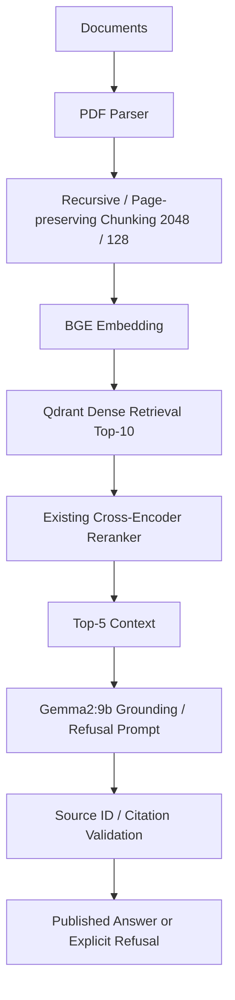

# FINAL ARCHITECTURE DECISION

最终架构：**Dense + Existing Cross-Encoder Reranker，Gemma2:9b，Citation ON，显式 score gate OFF**。

Answerability 由原 grounding/refusal prompt 与引用核验承担当前策略，不能称完备事实验证。显式门限默认OFF，实验配置保留但不重新拟合。Hybrid、BM25、RRF保留为 experiment/ablation，主架构不使用。

选择依据：Dense candidate R@10 已1.0；现有CE将R@1由0.6833→0.9583、MRR0.8052→0.9792；当前K10 BM25 unique rescue0；Hybrid+CE没有更高最终点估计，并增加词法索引/融合维护；score gate FAR不变且FRR上升。

这是实验支持下的简单有效架构，不是功能最多或被统计证明普适最优的架构。Dense+CE与Hybrid+CE差值CI含0，选型同时考虑复杂度。两者重复延迟同量级，不把80ms点差宣传为稳定速度收益。

保留的失败模式：版本排序、近似相关但缺失所问事实、候选batch依赖、context截断、无效/错误引用、LLM judge偏差。Citation precision仅是source归属代理。独立人工audit pending；自然检索 sanity check小且饱和；自然生成状态以release恢复日志为准。

参数及既有算法文件未改；当前配置入口 configs/demo/dense_reranker.yaml。所有失败例与被拒绝的替代方案保留可查。
